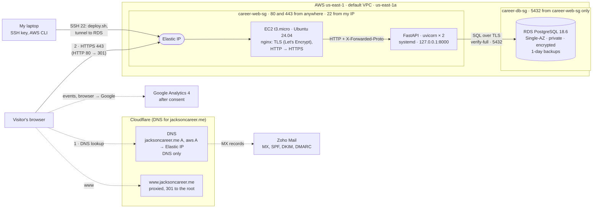

# Career Platform

**Live site: https://jacksoncareer.me** (`www.jacksoncareer.me` redirects there)

My personal career site: a FastAPI app that shows my profile, experience, education, skills, and projects, and a downloadable résumé PDF, all read from a database when the page is requested. A small authenticated admin API edits the content. It started in Codespaces in September 2026, ran on an Azure Ubuntu VM with nginx, systemd, and SQLite, then on Railway with PostgreSQL from 2026-10-11, and since 2026-11-09 runs on AWS: an EC2 instance with nginx and systemd, and an RDS PostgreSQL database. Email for the domain goes through Zoho Mail, and visits are measured with Google Analytics 4 after the visitor consents.

The Project 1 evidence is indexed in [`docs/project-1-submission.md`](docs/project-1-submission.md).

**Contents**

- Set up and run locally: [Local development](#local-development), [Checks](#checks)
- Update the live site: [Deploys](#deploys) (manual, with `deploy/deploy.sh`), [Server configuration](#server-configuration)
- [Architecture](#architecture): web, email, and analytics paths
- [Domains and DNS](#domains-and-dns)
- Outages and rollback: [Snapshot fallback and recovery](#snapshot-fallback-and-recovery), [Rolling back a bad change](#rolling-back-a-bad-change)
- Migration: [Railway to AWS](#railway-to-aws-2026-11-09), [How the migration preserved the data](#how-the-migration-preserved-the-data), [Azure to Railway: who manages what](#azure-to-railway-who-manages-what)
- [Analytics (GA4)](#analytics-ga4)
- [Decisions](#decisions): Railway migration, managed email, EC2 + RDS on AWS
- [Costs, credits, and cleanup](#costs-credits-and-cleanup)
- [Investigated failures](#investigated-failures) and [Remaining limitations](#remaining-limitations)
- [Reflection](#reflection)
- [Spec, plans, and history](#spec-plans-and-history)

## Architecture

**Current setup on AWS (since 2026-11-09).** Solid arrows are the web request path; dashed arrows are the parts that never touch the server.



Diagrams with locations, protocols, ports, and data flow for every stage, including Azure and Railway, are in [`docs/request-path.md`](docs/request-path.md):

1. **Azure (historical, 2026-09-29 to 2026-10-11):** browser → Cloudflare DNS (`A 52.159.85.45`) → Azure NSG (22 from my laptop, 80/443 from anywhere) → nginx on 80/443, where TLS ended → uvicorn (2 workers, systemd) on `127.0.0.1:8000` → SQLite file on the VM's disk.
2. **Railway (historical, 2026-10-11 to 2026-11-06):** browser → Cloudflare DNS (root CNAME, DNS only, flattened) → Railway's edge on 443, where TLS ended → app on port 8080 → PostgreSQL over Railway's private network.
3. **AWS (current, since 2026-11-09), `us-east-1`:** browser → Cloudflare DNS (root `A` to an Elastic IP, DNS only) → security group `career-web-sg` (80/443 from anywhere, 22 from my laptop only) → nginx on the EC2 instance, where TLS ends (Let's Encrypt) → uvicorn (2 workers, systemd) on `127.0.0.1:8000` → RDS PostgreSQL 18.6 on port 5432 over TLS (`verify-full`), reachable only from `career-web-sg`. `www` is answered by Cloudflare's edge with a 301 to the root.
4. **Email:** Gmail → MX lookup → Zoho's MX servers (SMTP 25) → my mailbox. Replies go out through Zoho's servers, and receivers check SPF, DKIM, and DMARC in Cloudflare DNS.
5. **Analytics:** after the visitor allows it, the browser loads `gtag.js` from Google and sends events straight to Google Analytics over HTTPS, never through the server.

## Local development

This application uses Python 3.11+ and FastAPI. `uv` is optional; the commands
below use standard Python tooling.

```bash
python -m venv .venv
. .venv/bin/activate
python -m pip install -e ".[test]"   # or: uv sync --extra test
uvicorn app.main:app --reload
```

Create the schema and representative profile with:

```bash
alembic upgrade head
python -m app.seed
```

The application is available at `http://127.0.0.1:8000`. Public pages include
`/`, `/about`, `/experience`, `/projects`, `/skills`, `/education`, `/contact`,
and `/resume.pdf`. The health check is at `GET /api/v1/health`.

Copy `.env.example` to `.env` to override non-secret runtime settings. Secrets
must be supplied through the deployment environment and must not be committed.

## Checks

```bash
pytest                       # with uv: uv sync --extra test && uv run pytest
python -m compileall app
```

`.python-version` pins Python 3.12 to match production. With uv, run
`uv sync --extra test` before `uv run pytest`, because a plain `uv run`
environment doesn't include the test tools.

`tests/test_postgres.py` holds live-Postgres tests that run only when
`TEST_DATABASE_URL` is set. They migrate up and down and insert rows, so point
the variable at a **scratch** database only. The fixture refuses any database
that is already migrated or has rows, so it can't run against production.

## Production on AWS

Since 2026-11-09 the site runs in AWS account resources tagged `Project=career-platform`, region `us-east-1`, profile `isba-4775`. The account belongs to the course and closes at the end of the term (see *Leaving AWS* below).

| Resource | What it is |
|---|---|
| EC2 `career-platform` | `t3.micro`, Ubuntu 24.04, 20 GB encrypted gp3, IMDSv2 required, `CpuCredits=standard`, in `us-east-1a`, with an Elastic IP |
| RDS `career-platform-db` | PostgreSQL 18.6, `db.t3.micro`, **Single-AZ**, not publicly accessible, encrypted, 1-day automated backups, deletion protection, in `us-east-1a` |
| Security groups | `career-web-sg`: 80 and 443 from anywhere, 22 from my laptop's IP only. `career-db-sg`: 5432 from `career-web-sg` only. |
| Database logins | `career_admin` (RDS master, used only from the laptop) and `career_app` (the app; owns the `career_platform` database) |

How it was built, step by step with results: [`docs/superpowers/plans/2026-11-03-aws-ec2-rds-migration.md`](docs/superpowers/plans/2026-11-03-aws-ec2-rds-migration.md). Every departure from that plan: [`migration-notes.md`](migration-notes.md).

### Deploys

**Pushing to GitHub does not deploy.** Deploys are manual, over SSH:

```bash
ssh -i ~/.ssh/aws_career_platform ubuntu@jacksoncareer.me
cd ~/career-platform && ./deploy/deploy.sh origin/main   # or any branch, tag, or commit
```

`deploy/deploy.sh` fetches, checks out the ref, runs `uv sync --locked --no-dev`, restarts the `career-platform` service, and waits for `/api/v1/health`. It prints the deployed commit, or the reason and the last 30 log lines and exits 1.

- **Service:** `deploy/career-platform.service` (installed at `/etc/systemd/system/`). Before uvicorn starts, systemd runs `alembic upgrade head`, then writes the content snapshot. A failed migration stops the start; a failed snapshot doesn't.
- **nginx:** `deploy/nginx-career-platform.conf` (installed as the only enabled site). HTTP redirects to HTTPS, except Let's Encrypt's renewal path.
- **A failed deploy takes the site down** until you deploy the previous commit again. There is one server and no old copy keeps serving. Tested 2026-11-09 with a deliberately failing migration.
- `scripts/start.sh`, `railway.json`, and `railpack.json` are Railway leftovers; EC2 doesn't use them.

### Server configuration

The app reads `~/career-platform/.env` on the instance (mode 600, never committed):

| Variable | Value |
|---|---|
| `DATABASE_URL` | `postgresql://career_app:<password>@<RDS endpoint>:5432/career_platform?sslmode=verify-full&sslrootcert=/etc/ssl/certs/rds-global-bundle.pem`. Generated passwords are hex, so they need no URL escaping. |
| `SESSION_SECRET` | A new random value generated on the server on 2026-11-09. **It must be set:** the default in `app/config.py` is public. |
| `SITE_URL` | `https://jacksoncareer.me` |
| `APP_ENV` | `production`. It also makes the admin session cookie `Secure`. |

The database passwords are in my password manager and in `~/.config/career-platform/rds-passwords.env` on my laptop (mode 600).

### Domains and DNS

| Name | Served by |
|---|---|
| `jacksoncareer.me` | `A` record to the EC2 Elastic IP, **DNS only**. nginx serves a Let's Encrypt certificate. |
| `www.jacksoncareer.me` | Cloudflare. A **proxied** placeholder A record (`192.0.2.1`) plus a redirect rule send `http://www` and `https://www` to `https://jacksoncareer.me` with a 301, keeping the path and query. See `docs/evidence/www-redirect.md`. |
| `aws.jacksoncareer.me` | `A` record to the same Elastic IP, DNS only, added 2026-11-09. nginx serves the same app over HTTPS with its own Let's Encrypt certificate; HTTP redirects to HTTPS on that name. Handy for SSH: `ssh ubuntu@aws.jacksoncareer.me`. |

The domain is registered at Namecheap, and its DNS is hosted on Cloudflare. The MX, SPF, DKIM, and DMARC records are Zoho's; don't change them. `_railway-verify.jacksoncareer.me` is a Railway leftover, to delete when the Railway project is deleted.

**Certificates:** `jacksoncareer.me` was issued 2026-11-09 through a Cloudflare DNS challenge, and `aws.jacksoncareer.me` the same day over HTTP. Both are valid until 2027-02-07. Both renew with the HTTP challenge (`webroot` at `/var/www/html`) and reload nginx afterwards; `certbot renew --dry-run` passes. `certbot.timer` checks twice a day.

### Operating it from the command line

```bash
export AWS_PROFILE=isba-4775 AWS_REGION=us-east-1
aws login --profile isba-4775                      # when the session has expired
ssh -i ~/.ssh/aws_career_platform ubuntu@jacksoncareer.me
sudo journalctl -u career-platform -f              # app logs
sudo tail -f /var/log/nginx/access.log             # requests
aws rds describe-db-instances --db-instance-identifier career-platform-db
```

- **SSH refused or timing out?** My laptop's IP has probably changed. Add the new `/32` to port 22 of `career-web-sg` and remove the old one (`authorize-security-group-ingress`, then `revoke-security-group-ingress`).
- **Database from the laptop:** RDS is private, so tunnel through the instance: `ssh -i ~/.ssh/aws_career_platform -N -L 55434:<RDS endpoint>:5432 ubuntu@jacksoncareer.me`, then connect to `127.0.0.1:55434` with `sslmode=require` (the hostname doesn't match through a tunnel, so `verify-full` can't be used there). Use the Homebrew 18.x client tools; Ubuntu's packaged client is too old for these dumps.
- **OS updates** install automatically, and the instance reboots itself at 11:00 UTC when an update needs it. The app and nginx start on their own (tested 2026-11-09).

### Data

The data came from Railway's last dump, `railway-20261029T220722Z.dump` (taken 2026-10-29 22:07 UTC, no edits after it). It was restored into RDS on 2026-11-09 with `pg_restore --no-owner --no-privileges --exit-on-error`, connected as `career_app`, so the app's login owns every table. `scripts/db_fingerprint.sql` printed identical per-table checksums and sequence values for the restore and for the dump's reference fingerprint.

Copies of the data:

- **RDS** (live) and its automated backups. Backups keep **only 1 day**, because AWS's free account plan refused 7.
- **Dumps outside AWS:** `~/backups/career-platform/` on my laptop, with `.sha256` checksums and `.fp` fingerprints. Keep a second copy off the laptop. RDS backups disappear with the account.

### Snapshot fallback and recovery

The app keeps a snapshot of the published content at `SNAPSHOT_PATH` (default
`data/public-profile.json`). systemd writes it from the database on
every start, right after migrating, and each successful public request rewrites
it. The file is gitignored, so a deploy never starts from placeholder content.
If the start can't write it (for example, no published profile), the app starts
without one.

| Situation | What a visitor gets |
|---|---|
| Database healthy | The page from the database, HTTP 200 |
| Database healthy, no projects published | "No projects are published yet.", HTTP 200 |
| Database read fails, snapshot exists | Profile from the snapshot, "Projects temporarily unavailable.", HTTP 503 on every public page. Snapshot projects are never shown. |
| Database read fails, no snapshot | HTTP 503 with no profile |

The resume PDF still comes from the snapshot during an outage, without
projects. Admin writes fail closed. The next request after the database
recovers returns 200 with projects, with no restart. Re-tested on EC2 on 2026-11-09 by blocking outbound 5432 on the instance's firewall.

To recover:

1. Check `sudo journalctl -u career-platform` and `GET /api/v1/health`. The health check doesn't
   touch the database, so a 503 on `/` with a 200 on health points at the
   database.
2. Check RDS is `available` (`aws rds describe-db-instances`), that `career-db-sg` still allows 5432 from `career-web-sg`, and the RDS events in the console. RDS may also be briefly restarting in its maintenance window (Sundays 10:00–10:30 UTC).
3. Reload `/` and confirm HTTP 200 with the projects listed.

### Rolling back a bad change

**Code:** deploy the last good commit: `./deploy/deploy.sh <good-sha>` on the instance. Fix `main` with `git revert <bad-sha>` afterwards, so the next deploy doesn't bring it back.

**If the bad change included a migration:** systemd runs `alembic upgrade head` on every start, so rolling back code alone leaves the newer schema. Run `.venv/bin/alembic downgrade <previous revision>` on the instance first (it reads `.env`), then deploy the old commit. Only one migration exists so far (`0001_initial`).

**Data:**

1. **Before any risky data or schema change**, take a dump through the SSH tunnel (`pg_dump --format=custom --no-owner`), and freeze admin edits.
2. **Within the last day**, RDS can restore to any point in time *as a new instance* (`aws rds restore-db-instance-to-point-in-time`); tested 2026-11-09. Point `DATABASE_URL` at it, or dump from it and restore into the main database.
3. **Older than a day:** restore a dump (`pg_restore --clean --no-owner --no-privileges`) and reload `/`.
4. **Data written after the copy** is lost by the restore. There's one admin (me), so re-enter those edits by hand.

**No Railway rollback anymore:** the Railway trial ended on 2026-11-06, and its database can't be reached.

### Leaving AWS

The account closes with the course term. Before then, follow Task 8 of the AWS plan: dump and verify the data outside AWS, move the site, then delete the instance, **release the Elastic IP** (an unattached one keeps billing), remove RDS deletion protection and delete RDS and its snapshots, then the subnet group, security groups, and key pair.

## Railway to AWS (2026-11-09)

| Layer | Railway | AWS (EC2 + RDS) |
|---|---|---|
| Deploy | Every push to `main`, with a health check before switching traffic | Manual `deploy/deploy.sh`; a failed deploy means downtime until rollback |
| Process | Railway's container and restart policy | systemd (`Restart=always`), starts at boot |
| TLS | Railway's edge, renewed by Railway | nginx with Let's Encrypt, renewed by certbot on the instance |
| OS | Railway's base image | Ubuntu 24.04 I run: unattended upgrades with automatic reboots |
| Database | Railway Postgres, no backups, no access from the laptop | RDS: patched by AWS, 1-day point-in-time backups, private, reached through an SSH tunnel |
| Network | Railway's private network | Two security groups; the database accepts only the web server |

The move didn't go to plan in one way that mattered: the hard-deadline backup before the Railway trial ended (2026-11-05) never ran, so the site was down from 2026-11-06 until the DNS switch on 2026-11-09, and the 2026-10-29 dump became the only copy. Nothing was lost only because nothing had been edited since. Details: `migration-notes.md`, D3.

## Azure to Railway: who manages what

The site ran on an Azure Ubuntu VM from 2026-09-29 and moved to Railway on 2026-10-11 (`docs/superpowers/plans/2026-10-10-railway-postgres-migration.md`, *Record*). The VM was deleted on 2026-10-13. This table compares who was responsible for each layer.

| Layer | Azure VM (I managed) | Railway (Railway manages) | What's still mine on Railway |
|---|---|---|---|
| Operating system | Ubuntu 24.04 on the VM: packages, updates, users, SSH keys | The container base image Railpack builds on | Nothing at the OS level, and there's no SSH by default |
| Network and firewall | NSG rules: 22 from my laptop's IP only, 80 and 443 from anywhere. I updated the SSH rule whenever my IP changed. | Railway's edge and its private network between the app and Postgres | Nothing to configure |
| Runtime | System Python 3.12.3 plus a `uv` virtual environment I created | Railpack installs Python and packages at each build | Choosing versions: `.python-version` and `uv.lock` |
| Process management | A systemd unit (`Restart=always`, starts at boot) running uvicorn with 2 workers on `127.0.0.1:8000` | Starts the container, restarts it on failure (up to 5 times, `railway.json`), and waits for `/api/v1/health` before switching traffic | The start command (`scripts/start.sh`: migrate, snapshot, uvicorn with 2 workers on `$PORT`) |
| Web entry point | nginx I installed and configured on 80/443, forwarding to the app | Railway's edge, forwarding plain HTTP to the app on port 8080 | `--proxy-headers` so the app trusts the edge's `X-Forwarded-Proto` |
| TLS certificate | Let's Encrypt via certbot on the VM, renewed by a timer there; TLS ended at nginx | Let's Encrypt certificate issued and renewed by Railway; TLS ends at Railway's edge | Keeping the root DNS-only and pointed at Railway, and keeping `_railway-verify`, or renewal fails |
| Application code | `git pull` on the VM, then a service restart, by hand | Builds and deploys every push to `main` automatically | The code, and reviewing a change before pushing, since a push is a production deploy |
| Configuration and secrets | `.env` on the VM, `chmod 600` | Stores service variables and injects them | Setting them correctly. Until 2026-10-26 `SESSION_SECRET` and `SITE_URL` were missing, and nothing warned me. |
| Database software | SQLite: a library inside the app, no server | Runs a PostgreSQL 18.6 container with a volume | Schema changes (Alembic, run at every boot). Postgres version upgrades: not checked who owns these. |
| Data | One file on the VM's disk, backed up by me with `sqlite3 .backup` | Stores it on the Postgres volume | Backups. I haven't set up or verified any Railway backups, so Railway Postgres is currently the only copy. |
| DNS | Cloudflare records pointing at the VM's IP | Nothing | All of it: Cloudflare records, the `www` redirect, and the Zoho mail records |
| Logs and checks | `journalctl`, `ss`, `systemctl` over SSH | Keeps build and runtime logs (`railway logs`) | Reading them, and checking the site after each deploy |

**What Railway didn't take off my hands:** the parts that are specific to my site. That's code, configuration and secrets, data and its backups, DNS, schema migrations, dependency versions, and checking that a deploy worked. Three gaps showed up after the move:
- The service variables were incomplete for 15 days.
- `www` was broken from 2026-10-13 to 2026-10-26.
- There's no backup of the production database.

Platform deadlines were mine to track too: Railway stopped supporting `railway.json` after 2026-12-01. That no longer matters since the move to AWS.


## Analytics (GA4)

The site uses Google Analytics 4, measurement ID `G-XWCRC21WXW`, and only after the visitor agrees. The code is the consent banner and tag at the end of `app/templates/base.html`. The Privacy page (`/privacy`) explains it to visitors.

**How a visit reaches Google Analytics**

1. The server (nginx and the app on EC2) serves the page. Every page sets Google's Consent Mode default to `denied` (`analytics_storage`, `ad_storage`, `ad_user_data`, `ad_personalization`). Nothing is sent to Google, and `gtag.js` isn't loaded yet.
2. The banner asks the visitor. The choice is saved in the browser's `localStorage` as `analytics-consent`, so the banner doesn't reappear on every page.
3. **Allow:** the page calls `gtag('consent', 'update', {analytics_storage: 'granted'})`, then `gtag('config', 'G-XWCRC21WXW')`, and loads `gtag.js` from `www.googletagmanager.com`. **Decline:** nothing loads, and any `_ga` cookies are deleted.
4. `gtag.js` sends a `page_view` event, and GA4's **enhanced measurement** adds automatic events, including `click` for links to another domain (`outbound = true`). The site defines no custom events.
5. Each event is an HTTPS request **from the visitor's browser straight to Google** (`…google-analytics.com/g/collect`). It never passes through nginx or the app, which is why the server logs show none of it.
6. GA4 shows the events in **Realtime** within seconds, and in standard reports later.

**What the checks showed:** on 2026-10-25 at 8:10 PM PDT, after allowing analytics in a private window, I clicked the LinkedIn button. Realtime showed `page_view` for the visit and a `click` event with `link_domain = linkedin.com`, `link_url` set to my LinkedIn profile, and `outbound = true`. Enhanced measurement has Page views and Outbound clicks turned on. Details: `docs/evidence/ex06.md`, section 3.

**Limits**
- Visitors who decline, block scripts, or use an ad blocker aren't counted, so GA4 undercounts real visits.
- Counts of my own test visits are mixed in with real ones. No internal-traffic filter is set up.
- I didn't watch the `/g/collect` requests in the browser's Network tab, so the "nothing is sent before Allow" claim rests on the code and the Consent Mode default, not on an observed check.


## How the migration preserved the data

Records: [`docs/superpowers/plans/2026-10-10-railway-postgres-migration.md`](docs/superpowers/plans/2026-10-10-railway-postgres-migration.md) (Task 5 results and the *Record* section).

1. **Plan first.** The plan and the migration code were committed 2026-10-11 00:14–00:21 UTC (`f5fa2d1` … `7cd922f`), before anything on the live site changed.
2. **Compatibility.** SQLite-to-Postgres differences were fixed and tested before the copy: the psycopg driver URL (`f5fa2d1`), a `%` in the password breaking Alembic (`f5fa2d1`), the `status` enum type left behind by downgrade (`0ca8844`), and id sequences after copying rows with their ids (`e4907ee`).
3. **Consistent source copy.** Admin edits were frozen and the VM database was copied with SQLite's online `.backup` at 00:26:35 UTC, checked by SHA-256 and `integrity_check`.
4. **Copy.** `python -m app.copy_db` copied every row into the empty, migrated Railway database, keeping ids, and refuses a target that already has rows.
5. **Comparison.** VM live, the backup, and Railway were compared table by table, row by row, and column by column: identical in all 10 tables. All 10 id sequences were checked: the next id is `max(id)+1`.
6. **Not re-seeded.** The seed script creates "Ada Analyst." The VM held my real résumé content, loaded 2026-09-30, and Railway has exactly that. See the Step 5 annotation in the plan.
7. **Cutover.** DNS moved at 01:51:12 UTC (Cloudflare audit log).

**Not done:** the rendered pages and PDF of the VM and Railway were never compared (plan Task 5 Step 6), and the VM is gone, so that comparison can't be made now.

## Decisions

> **Written 2026-10-26 from the repository's records.** I wrote both decisions in class, but those originals were lost. These reconstructions use the plans, commits, and evidence linked in each one, and the vendor facts were checked on 2026-10-26. Decision 3 was written on 2026-11-09 from the AWS plan, `migration-notes.md`, and my choices recorded during that migration.

### 1. Move the site from the Azure VM to Railway with PostgreSQL

**Context.** The course required moving the running site from the Azure VM to Railway. The choices that remained were what database to use there, how to move the data, and how to switch over safely. Railway's trial lasts 30 days or $5 of usage and allows one custom domain.

**Alternatives considered**
- **Stay on the Azure VM.** I already knew how it worked, but I'd keep patching Ubuntu, nginx, certbot, and the NSG myself, and the course required the move.
- **Railway with SQLite.** It needed the fewest code changes, but a Railway container's filesystem is reset on every deploy, so a database file would be lost unless I attached and managed a volume for it.
- **Railway with PostgreSQL (chosen).** Railway runs the database as its own service on a private network, and the app already reached the database only through SQLAlchemy and one `DATABASE_URL`.
- **How to move the data:** re-run the seed script (rejected: it creates the demo "Ada Analyst" profile and would lose my real content), or copy every row from the VM's SQLite into Postgres with the same ids (chosen, `app/copy_db.py`, `e4907ee`).

**Reasons**
- Railway takes over the operating system, the web entry point, TLS certificates, and restarts (see *Azure to Railway: who manages what*).
- PostgreSQL avoids the reset-on-deploy problem and is the engine the original spec suggested ("PostgreSQL or equivalent").
- Copying rows with their ids keeps every record and its relationships exactly as on the VM, and can be checked row by row.
- Keeping the VM unchanged gave a rollback (point DNS back) until it was deleted on 2026-10-13.

**Trade-offs I accepted**
- Engine differences to fix first: the driver URL, the enum type, and id sequences (`f5fa2d1`, `0ca8844`, `e4907ee`).
- Less control and visibility: no SSH by default, and no database access from my laptop without extra setup.
- A short-lived platform: the trial ends, and the site moves again to AWS after the midterm.

**How it turned out.** The data arrived identical in all 10 tables and the cutover happened at 01:51:12 UTC on 2026-10-11 (*How the migration preserved the data*). The trade-offs also showed up: two service variables went unset for 15 days, and there's still no database backup.

### 2. Use managed email (Zoho Mail) instead of hosting my own

**Context.** I wanted a resume-ready address at my domain (`jackson@jacksoncareer.me`) that can send, receive, and reply, and passes SPF, DKIM, and DMARC.

**Alternatives considered**
- **Self-host a mail server** (for example Postfix and Dovecot) on the Azure VM.
- **Cloudflare Email Routing.** Free and already where my DNS is, but it only forwards incoming mail to another inbox. It can't send as `jackson@jacksoncareer.me`.
- **Google Workspace or Microsoft 365.** Full-featured, but paid per user.
- **Zoho Mail Forever Free (chosen).** One domain, up to 5 users, 5 GB per user, webmail only: IMAP, POP, and ActiveSync aren't included (zoho.com/mail pricing page, read 2026-10-26).

**Reasons**
- **Self-hosting wasn't workable on my subscription.** Azure blocks outbound SMTP on TCP port 25 from VMs for every subscription type except Enterprise Agreement and MCA-E (Microsoft Learn, "Troubleshoot outbound SMTP connectivity issues in Azure," read 2026-10-26), so my VM couldn't deliver mail directly to other servers. Running my own server would also have meant managing spam filtering, mail TLS, IP reputation, and security updates myself.
- **The VM was going away.** The site was moving to Railway, and Railway doesn't host mail servers. Email tied to the VM would have had to move again.
- **Managed email is separate from the website.** MX records send mail straight to Zoho, so moving the site from Azure to Railway didn't touch email.
- **It's free and does what the project needs:** send, receive, and reply from my domain, with SPF, DKIM, and DMARC.

**Trade-offs I accepted**
- Webmail only on the free plan, no IMAP client.
- My mail is stored by a third party under its terms.
- Deliverability depends on Zoho's servers and reputation.

**How it turned out.** Inbound mail arrived on 2026-10-13. A webmail reply on 2026-10-25 reached Gmail's Inbox in 5 seconds with SPF, DKIM, and DMARC passing for `jacksoncareer.me` (`docs/evidence/zoho-header-check.md`, `docs/evidence/ex06.md`).

### 3. Move from Railway to AWS with EC2 and a Single-AZ RDS database

**Context (2026-10-29 to 2026-11-03).** The Railway trial was ending on 2026-11-06 and the course moved the site to AWS. I compared three AWS designs: EC2 with PostgreSQL on the same instance, EC2 with RDS, and Lambda with API Gateway and RDS.

**Decision.** EC2 for the app and RDS PostgreSQL, Single-AZ, `t3.micro` and `db.t3.micro` (the course policy blocks `t4g`).

**Why.** I wanted to learn to run a server again (nginx, systemd, TLS) but not to run the database myself: RDS handles patching and backups. EC2 with a local database was cheaper and faster to deploy, but leaves backups to me. Lambda was the least to operate but needed the most code changes before the deadline. Single-AZ because one small personal site doesn't justify paying for a standby.

**Trade-offs accepted.** It's the most expensive of the three, about $28/month on demand. Deploys are manual and a failed one means downtime. The account is temporary. AWS's free plan then limited backups to 1 day.

**How it turned out.** Live on 2026-11-09, three days after Railway went down, because the backup and cutover planned before the trial ended didn't happen. See *Railway to AWS* above.

## Costs, credits, and cleanup

Recorded 2026-10-25 (PDT); AWS and Railway rows updated 2026-11-09. Balances come from each provider's dashboard, read by me, except where noted.

| Service | What it provides | Kind | Plan / credit | Spent so far | Expires or renews | Cleanup plan |
|---|---|---|---|---|---|---|
| **AWS** (course account, profile `isba-4775`) | EC2 `t3.micro`, 20 GB EBS, Elastic IP, RDS `db.t3.micro` Single-AZ with 20 GB gp3 and 1-day backups | Compute, storage, network (public IPv4), backups | AWS free account plan; owned by the course. My login can't see billing or credits. | Unknown (no billing access). Estimated **$28.28/month on demand** before credits, from AWS's public price lists on 2026-11-03. | **Account closes with the term** (date to confirm with the instructor) | Follow *Leaving AWS* before the account closes. Ask whoever has billing access to set a budget alert. |
| **Railway** (project `prolific-enthusiasm`) | Was the app and Postgres. **Trial ended 2026-11-06;** services failed or removed, database unreachable. | — | Free trial: $5 of credit, 30 days | $0.51 as of 2026-10-25 | Ended 2026-11-06 | Delete the project and the `_railway-verify` TXT record after the AWS site has run cleanly for 48 hours. |
| **Azure for Students** (through the GitHub Student Developer Pack) | Was the VM, OS disk, NIC, static public IP, NSG, and virtual network in `rg-career-platform` | Compute (VM, deleted), storage (OS disk, deleted), **network (static IP, still billed while it exists)** | $100 credit per year, renewable with valid student standing | $4.08 of $100 | Credit expires in 332 days, about **2027-09-22** | The VM, disk, and NIC were deleted 2026-10-13 as instructed. Still to do: release the static IP `vm-career-platform-ip` (nothing points to it since 2026-10-26) and delete the rest of `rg-career-platform`, once the instructor's cleanup directions confirm it. |
| **Namecheap** | Registration of `jacksoncareer.me` | Other (domain) | Free first year | $0 | Registered 2026-10-01; **renews 2027-10-01 for $23.98** | Decide before 2027-10-01 whether to renew. If it lapses, the site's address and the Zoho mailbox both stop working. |
| **Cloudflare** | Authoritative DNS, the `www` redirect, the edge certificate for `www` | Other (DNS) | Free plan (zone shows "Free Website", checked 2026-10-26) | $0 | No expiry | Keep. Nameservers stay delegated to Cloudflare. |
| **Zoho Mail** | Mailbox `jackson@jacksoncareer.me` | Retained storage (mail) | Free; I don't pay for it | $0 | No expiry stated | Keep. Its MX, SPF, DKIM, and DMARC records must stay in Cloudflare. |
| **Google Analytics 4** | Property `G-XWCRC21WXW` | Other (analytics) | Free | $0 | — | Keep. |
| **GitHub** | Public repository `jacksonddorr-dev/career-platform` | Other (source) | Free | $0 | — | Keep. |

- **Total spent so far:** $0.51 of Railway trial credit and $4.08 of Azure student credit. No money out of pocket.
- **The Azure figure is the portal's credit balance.** The usage API (`az consumption usage list`) reported $0.00 for the same resources, probably because student-credit usage isn't returned there. Not investigated further.

## Investigated failures

Each row links to the record with the symptom, checks, diagnosis, repair, and repeated check.

| Failure | Kind | Real or deliberate | Symptom → diagnosis → repair → re-check | Record |
|---|---|---|---|---|
| No `uv.lock` for `uv sync --locked` | Application dependency | Real (Azure build) | Plan assumed a lock file; `git ls-files` showed none → generated `uv.lock` on the laptop and committed it (`1e5ee06`) → `uv lock --check` exit 0, tests passed, VM installed 28 packages | [`docs/evidence/ex03.md`](docs/evidence/ex03.md) §3.1 |
| Other Azure build issues: tests overwriting the snapshot, unsaved `.env`, wrong PID file, false "running" check, SSH blocked after IP change | Application / network | Real | Each with what happened, how it was found, and what confirmed the fix | [`docs/evidence/ex03.md`](docs/evidence/ex03.md) §3.2–3.6 |
| Old A record and mismatched certificate after a move to Railway | DNS / TLS | **Deliberate, simulated lab** (given output; the repair was interpreted, not run) | `curl` error 60 → `dig` still returned the old A record → replace with Railway's CNAME → the expected output shows the CNAME and HTTP 200 | [`docs/evidence/ex05.md`](docs/evidence/ex05.md) |
| `www.jacksoncareer.me` not responding (2026-10-13 to 2026-10-26) | DNS | Real | `www` timed out → Cloudflare listed `www` as a DNS-only A record to the deleted VM, so the existing redirect rule never ran → made `www` a proxied placeholder → `curl` shows 301 to the root and 200, certificates verify | [`docs/evidence/www-redirect.md`](docs/evidence/www-redirect.md) |
| Railway build failed: "No start command detected" (2026-10-25) | Deployment / config | Real | Redeploy `a46a5e88` FAILED → Railpack wasn't reading the start command → added `railpack.json` (`7a2113b`) → uncached rebuild `2eb776be` SUCCESS, log shows `sh scripts/start.sh` | [`docs/evidence/postgres-password-rotation.md`](docs/evidence/postgres-password-rotation.md) |
| Database outage served stale content with 200 | Application / database | Found by audit; live check deliberate | Code served the snapshot with 200 → changed to 503 with "Projects temporarily unavailable" (`4afc2ee`) → live Postgres restart gave 11 × 503 then 200 with projects | [`docs/evidence/reviewed-change.md`](docs/evidence/reviewed-change.md); `TASKS.md` final section |
| Railway service variables missing (until 2026-10-26) | Configuration / security | Real | Canonical links pointed to `127.0.0.1`; a name-only variable listing showed only `DATABASE_URL`, so sessions were signed with the public default secret → set `SESSION_SECRET`, `SITE_URL`, `APP_ENV` → canonical correct, old-secret cookie gets 401 | Railway plan, Task 5 Step 1 annotation |

| RDS creation refused: `FreeTierRestrictionError` (2026-11-03) | Cloud account limits | Real | `create-db-instance` with 7-day backups failed: "backup retention period exceeds the maximum available to free tier customers" → the account is on AWS's free plan → retried with 1-day retention (my choice) → instance `available` with the planned settings | `migration-notes.md` D1; AWS plan Task 3 |
| `deploy.sh` exited 1 without saying why (2026-11-09) | Deployment | **Deliberate test** that found a real bug | Deployed a branch with a failing migration → exit 1 but no logs, because `systemctl restart` failed under `set -e` before the log step → print logs when the restart fails, with a test (`9fcc825`) → re-run shows the reason and the migration error; rollback works | `migration-notes.md` D8; AWS plan Task 4 Step 11 |
| Site down after the Railway trial ended (2026-11-06 to 2026-11-09) | Hosting / process | Real | Railway returned 404 "Application not found" → the trial had ended before the planned backup and cutover → deployed to AWS from the 2026-10-29 dump and switched DNS → HTTPS 200 on every page, mail and GA4 confirmed | `migration-notes.md` D3; AWS plan Task 6 |

## Remaining limitations

- **RDS backups keep only 1 day** (AWS's free account plan limit). Older recovery depends on dumps kept outside AWS, and the only dump so far is from 2026-10-29.
- **The site was down from 2026-11-06 to 2026-11-09**, because the pre-deadline backup and cutover didn't happen before the Railway trial ended.
- **A failed deploy means downtime** until the previous commit is deployed again. There's one server, and deploys aren't automated or tested before they go live.
- **No monitoring or budget alert yet.** Nothing warns me if the site goes down, and my AWS login can't see the bill.
- **SSH works from one IP**, so a new laptop IP means updating `career-web-sg` before I can get in.
- **The AWS account ends with the term**, so this hosting is temporary.
- **The certbot account has no email address**, so Let's Encrypt can't send expiry warnings.
- **Admin activity isn't logged**, so whether anyone used the public default session secret before 2026-10-26 is unknown.
- **The site answers HEAD requests with 405** (GET-only routes), which can confuse uptime checkers and `curl -I`.
- **GA4 undercounts** visitors who decline or block scripts, and my test visits aren't filtered out.
- **The Azure static IP `52.159.85.45`** and its NSG and virtual network still exist in `rg-career-platform` and should be cleaned up.
- **Railway leftovers:** the project itself, the `_railway-verify` record, the Railway SSH key, and `railway.json`, `railpack.json`, and `scripts/start.sh` in the repo.

## Reflection

Building my career platform showed me how many separate pieces have to work together for one website to run. I deployed it on Railway, managed the domain and DNS through Cloudflare, and set up many other services along the way. The most valuable aspect was learning to troubleshoot. After a security incident paused Railway deployments, I rotated my database credentials and learned why reference variables keep services in sync better than pasted connection strings. My next redeploy failed with a "no start command" error, even though the same code had worked minutes earlier. By comparing the two builds and working with the Claude coding agent, I was able to accurately troubleshoot and fix the problem. Using an AI agent made the work faster, but I still had to understand its reasoning and decide which actions to approve, especially with passwords and production deployments. If I did this again, I would record checks on the day instead of reconstructing them afterward. Overall, I feel much more confident building a system from start to finish and fixing it when something breaks.

## Spec, plans, and history

- Original design spec: [`docs/superpowers/specs/2026-09-15-career-platform-design.md`](docs/superpowers/specs/2026-09-15-career-platform-design.md). Section 12.1, added afterward, explains the SQLite choice.
- Implementation plan: [`docs/superpowers/plans/2026-09-15-career-platform-implementation.md`](docs/superpowers/plans/2026-09-15-career-platform-implementation.md)
- Azure VM migration plan: [`docs/superpowers/plans/2026-09-24-azure-vm-migration.md`](docs/superpowers/plans/2026-09-24-azure-vm-migration.md)
- Operate-the-VM plan (nginx, systemd, verification, and the decommission note): [`docs/superpowers/plans/2026-10-01-operate-the-vm.md`](docs/superpowers/plans/2026-10-01-operate-the-vm.md)
- Railway and PostgreSQL migration plan, which stands in for a separate spec: [`docs/superpowers/plans/2026-10-10-railway-postgres-migration.md`](docs/superpowers/plans/2026-10-10-railway-postgres-migration.md)
- AWS EC2 + RDS migration plan, with results per step: [`docs/superpowers/plans/2026-11-03-aws-ec2-rds-migration.md`](docs/superpowers/plans/2026-11-03-aws-ec2-rds-migration.md); deviations from it: [`migration-notes.md`](migration-notes.md); evidence: [`docs/evidence/aws-migration.md`](docs/evidence/aws-migration.md)
- HTTPS write-up (Exercise 4, with Azure and Railway addenda): [`docs/how-this-site-is-secured.md`](docs/how-this-site-is-secured.md)
- Audit checklist and live outage record: [`TASKS.md`](TASKS.md)

Notes marked "written afterward" were added on 2026-10-26 while reconstructing this record. The plans' original steps are unchanged. Commit history: `git log --oneline` (the first commit is 2026-09-15).

