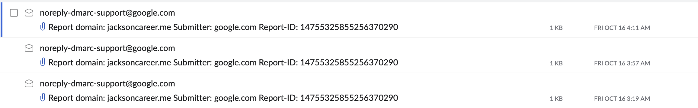
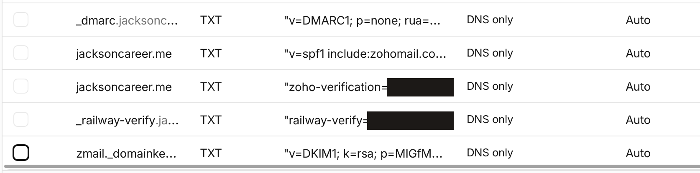
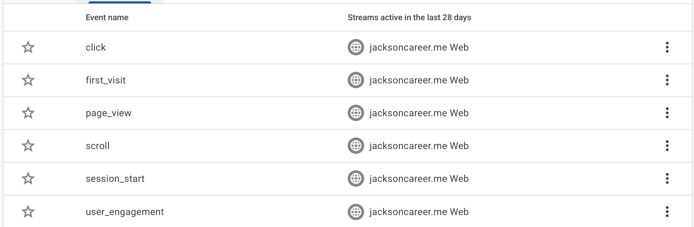

# ex06

## 1. Email tests

Domain mailbox: `jackson@jacksoncareer.me` (Zoho Mail). Outside mailbox: a personal Gmail account (address left out). Times are Pacific (PDT).

| Test | Subject | From → To | Time | Result | Arrived in outside mailbox |
|---|---|---|---|---|---|
| Received | Test 01: inbound | outside Gmail → jackson@jacksoncareer.me | 2026-10-13 14:54:12 | Delivered to the Zoho Inbox | n/a (inbound test) |
| Replied | Re: Test 01: inbound | jackson@jacksoncareer.me → outside Gmail | 2026-10-19 13:09:55 | Sent through the Zoho Mail MCP server. Zoho accepted it (HTTP 200) and saved it in Sent. No bounce came back. The MCP server has no reply action, so this was sent as a new message with a "Re:" subject and isn't threaded under Test 01. | _Check Gmail_ |
| Sent new | Test 06: new outbound | jackson@jacksoncareer.me → outside Gmail | 2026-10-19 13:09:55 | Sent through the Zoho Mail MCP server. Zoho accepted it (HTTP 200) and saved it in Sent. No bounce came back. | _Check Gmail_ |

## 2. SPF, DKIM, and DMARC results

**Domain setup (DNS lookup, 2026-10-19 13:24 PDT).** These records confirm the setup, not whether a particular message passed.

Here I asked Claude code retrieved the SPF, DKIM, and DMARC DNS records on Cloudflare as well as the 3 MX records
I have attached a screenshot as well as ex06-TXTs
| Record | Name | Value found |
|---|---|---|
| SPF | `jacksoncareer.me` TXT | `v=spf1 include:zohomail.com ~all` |
| DKIM | `zmail._domainkey.jacksoncareer.me` TXT | `v=DKIM1; k=rsa; p=…` (public key left out) |
| DMARC | `_dmarc.jacksoncareer.me` TXT | `v=DMARC1; p=none; rua=mailto:jackson@jacksoncareer.me` |
| MX | `jacksoncareer.me` | `10 mx.zoho.com`, `20 mx2.zoho.com`, `50 mx3.zoho.com` |

I have attached the DMAC record reports on the Zoho MCP here:

Here I have attached the screenshot of the TXTs for SPF, DKIM, and DMARC,records from cloudflare

## 3.
Privacy page: https://jacksoncareer.me/privacy
Live URL: https://jacksoncareer.me
Screenshot to confirm click and outbound: 

