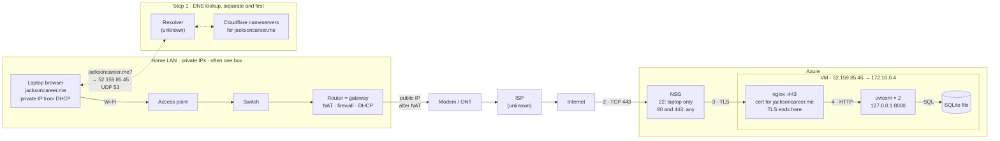
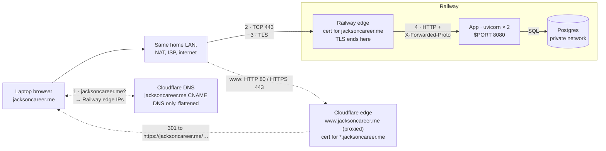
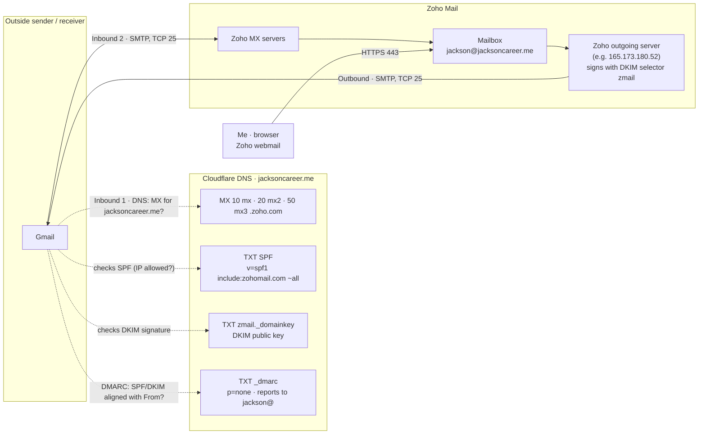
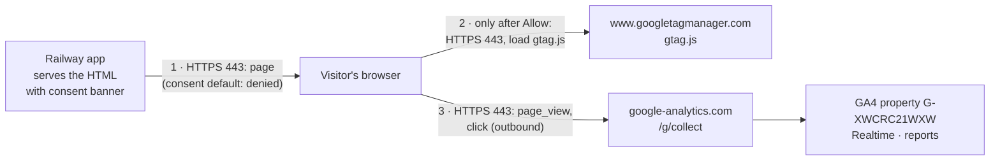

# Architecture diagrams

The web request path on Azure (historical) and on Railway (current), plus the email and analytics paths. Diagrams 1–2 were drawn 2026-10-20 as a midterm study reference; diagrams 3–4 and the `www` redirect were added 2026-10-26. All are drawn from the repository's records (`docs/superpowers/plans/2026-10-01-operate-the-vm.md`, `scripts/start.sh`, `README.md`, `docs/evidence/dns-before-zoho.md`). Anything marked `?` or "unknown" isn't confirmed by the repository.

**Assumptions:** no cached DNS answer, a new TCP connection, and the browser tries `http://jacksoncareer.me` first and follows the 301 to `https://jacksoncareer.me`.

**Unverified:** the home network devices and addresses (no Exercise 01 evidence in the repo). The NSG's TCP 443 rule, unknown when this was first drawn, was confirmed on 2026-10-26: `Allow-HTTPS-443`, created 2026-10-08 01:34 UTC (`docs/how-this-site-is-secured.md`, Azure addendum).

## 1. Azure (2026-09-29 to 2026-10-11; VM deleted 2026-10-13)

## 2. What changes on Railway

**Gone vs. Azure:** NSG rules, nginx, systemd, SSH, the SQLite file. **Still yours:** code, config and secrets, data, DNS.

## Steps

| Step | Client → server | Protocol and port | Azure | Railway |
|---|---|---|---|---|
| 1 | Laptop → resolver → Cloudflare | DNS, UDP 53 | Answer `52.159.85.45` | Root CNAME flattened, answer is Railway edge IPs |
| 2 | Browser → web entry | TCP 443 | NSG lets it reach nginx | Railway edge |
| 3 | Browser → web entry | TLS: browser checks hostname `jacksoncareer.me`, dates, chain | Ends at nginx (Let's Encrypt) | Ends at Railway's edge (Railway-issued cert) |
| 4 | Web entry → app | Plain HTTP | nginx → `127.0.0.1:8000` | Edge → app on 8080; `--proxy-headers` tells it the request was https |
| 4b | App → database | SQL | Local file, no network | Postgres over Railway's private network |
| 5 | Response | Same path back | Router NAT maps the reply to the laptop | Same |
| 6 | Browser | New HTTP requests | CSS, JS, images | Same |

## 3. Email (Zoho Mail, since 2026-10-13)

Inbound mail never touches Railway or the site: the MX records send it straight to Zoho. For outbound mail, Gmail looks up my SPF, DKIM, and DMARC records in Cloudflare DNS and decides whether to trust the message. On 2026-10-25 all three passed for `jacksoncareer.me` (`docs/evidence/zoho-header-check.md`). The SMTP port between mail servers (25) is the standard one. I didn't observe it directly.

## 4. Analytics (GA4)

Analytics events go from the visitor's browser straight to Google. They never pass through Railway, so the app's logs don't show them. Before the visitor clicks **Allow analytics**, nothing is loaded from Google (Consent Mode default `denied`). On 2026-10-25 Realtime showed `page_view` and an outbound `click` to LinkedIn (`docs/evidence/ex06.md`, section 3). The collection hostname is shown generically; I didn't capture the exact host in the Network tab.

