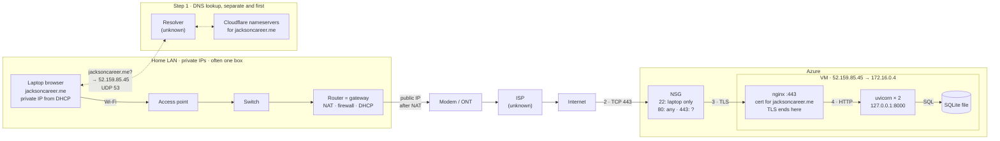
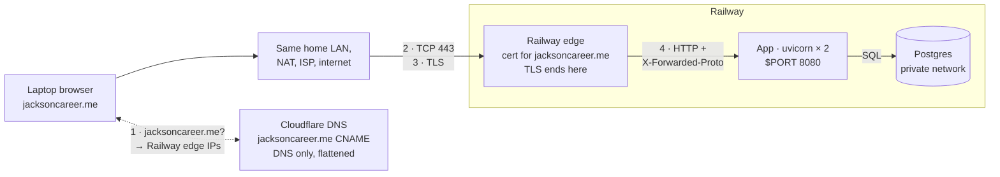

# Request path: entering jacksoncareer.me in a browser

Drawn 2026-10-20 as a midterm study reference, from the repository's records (`docs/superpowers/plans/2026-10-01-operate-the-vm.md`, `scripts/start.sh`, `README.md`, `docs/evidence/dns-before-zoho.md`). Anything marked `?` or "unknown" isn't confirmed by the repository.

**Assumptions:** no cached DNS answer, a new TCP connection, and the browser tries `http://jacksoncareer.me` first and follows the 301 to `https://jacksoncareer.me`.

**Unverified:** the home network devices and addresses (no Exercise 01 evidence in the repo), and whether the NSG has a TCP 443 rule (the 2026-10-08 record lists only 22 and 80).

## 1. Azure

## 2. What changes on Railway

**Gone vs. Azure:** NSG rules, nginx, systemd, SSH, the SQLite file. **Still yours:** code, config and secrets, data, DNS.

## Steps

| Step | Client → server | Protocol and port | Azure | Railway |
|---|---|---|---|---|
| 1 | Laptop → resolver → Cloudflare | DNS, UDP 53 | Answer `52.159.85.45` | Root CNAME flattened, answer is Railway edge IPs |
| 2 | Browser → web entry | TCP 443 | NSG lets it reach nginx | Railway edge |
| 3 | Browser → web entry | TLS: browser checks hostname `jacksoncareer.me`, dates, chain | Ends at nginx (Let's Encrypt) | Ends at Railway's edge (Railway-issued cert) |
| 4 | Web entry → app | Plain HTTP | nginx → `127.0.0.1:8000` | Edge → app on 8080; `--proxy-headers` tells it the request was https |
| 4b | App → database | SQL | Local file, no network | Postgres over Railway's private network |
| 5 | Response | Same path back | Router NAT maps the reply to the laptop | Same |
| 6 | Browser | New HTTP requests | CSS, JS, images | Same |
