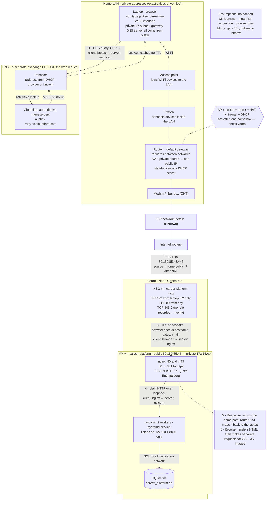
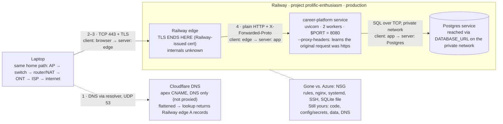

# Request path: entering jacksoncareer.me in a browser

Drawn 2026-10-20 as a midterm study reference, from the repository's records (`docs/superpowers/plans/2026-10-01-operate-the-vm.md`, `scripts/start.sh`, `README.md`, `docs/evidence/dns-before-zoho.md`). Anything marked `?` or "unknown" isn't confirmed by the repository.

Unverified: the home network devices and addresses (no Exercise 01 evidence in the repo), and whether the NSG has a TCP 443 rule (the 2026-10-08 record lists only 22 and 80).

## 1. Azure, end to end

## 2. What changes on Railway

